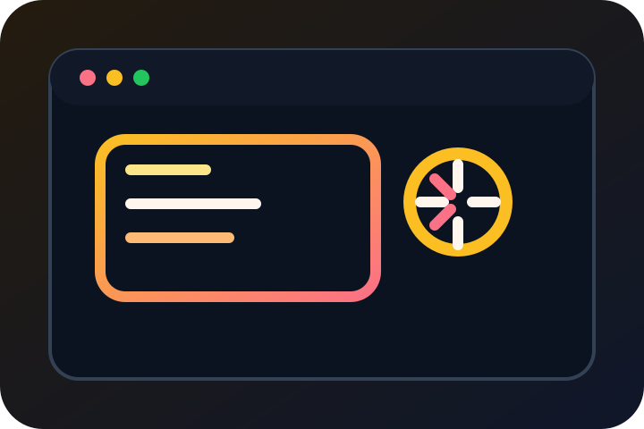

<div align="center">



# tools-screenshot

Capture any window on Windows in high resolution, with the browser toolbar removed automatically.

</div>

---

## What it does

- Captures a specific window, not just the whole screen
- Removes the browser navigation bar (Firefox, Chrome, Edge, Brave, Opera, Vivaldi, Arc, Zen…)
- Makes the image larger and sharper
- Handles multiple monitors
- Saves as PNG, JPG or WebP

Works on Windows with Node.js 20.9 or newer.

---

## Install

```bash
npm install -g tools-screenshot
```

This installs two commands: `sw` and `screenshot-win`.

---

## Quick start

```bash
# Pick a window from a menu
sw

# See the available windows
sw --list

# Capture an app
sw --app firefox
sw --app chrome --scale 3

# Choose the output file and format
sw --app firefox --output ./shot.webp

# Keep the browser toolbar
sw --app firefox --no-trim-nav
```

By default, images are saved in `./captures/` and enlarged 2×.

If several windows belong to the same app, use the id shown by `--list`:

```bash
sw --id 12345678
```

---

## Options

| Option            | Description                              |
| ----------------- | ---------------------------------------- |
| `--app <name>`    | App or window name to capture            |
| `--id <id>`       | Exact window id (shown by `--list`)      |
| `--scale <n>`     | Enlargement factor, default `2`          |
| `--width <n>`     | Target width in pixels (overrides scale) |
| `--output <path>` | Output file (`.png`, `.jpg` or `.webp`)  |
| `--trim-nav`      | Force toolbar removal                    |
| `--no-trim-nav`   | Keep the toolbar                         |
| `--list`          | List open windows                        |

---

## Use from code

```js
const { capture, listWindows } = require('tools-screenshot');

// List open windows: { id, title, process, isBrowser }
const windows = listWindows();

// Capture a window
const result = await capture({
  app: 'firefox',
  scale: 2,
  output: './firefox.png',
});

console.log(result.finalWidth, result.finalHeight);
console.log(result.output);
```

Main options: `app`, `windowId`, `scale`, `width`, `output`, `trimNav`.

---

## Good to know

- **Windows only.**
- If the window is behind another one, the tool tries to capture it directly. This works for most apps, but not all. For the best result, keep the window visible.
- A window spread across several monitors is captured from the monitor where most of it is.
- Toolbar removal is automatic for browsers. Use `--no-trim-nav` to keep it, or `--trim-nav` to force it on another app.
- Minimized windows cannot be captured.

---

## Development

```bash
npm install
npm test
npm run check
```

---

## License

MIT
